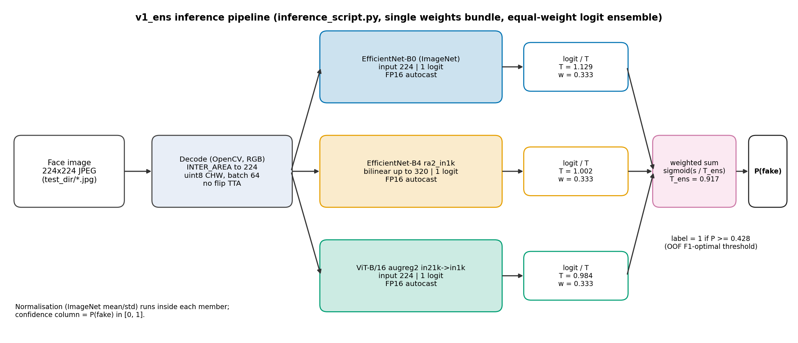
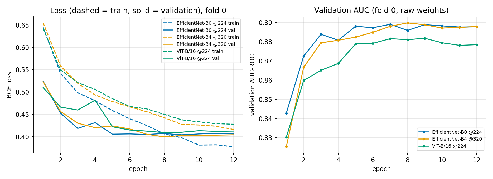
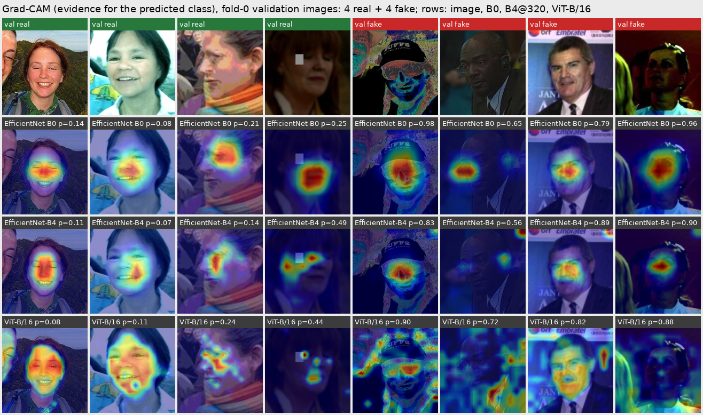
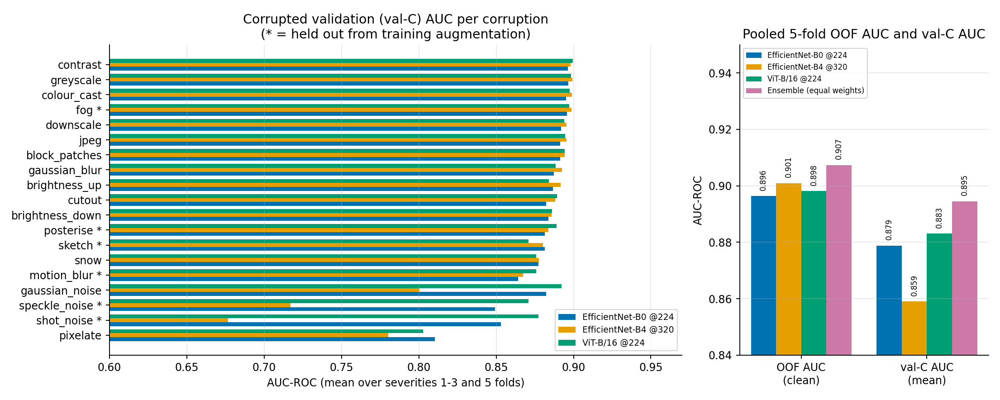

# Robust Deepfake Face Detection under Heavy Corruption

**Deepfake ML Hackathon, Synergy '26 (IIIT Bangalore)** · Team **abhijayjindal604** (solo) · Technical report
**Final build:** 12 Nov 2026 (submission `v1_ens`, three-model ensemble).

Source code: `<GitHub URL>` · Weights SHA-256: see §7.4 · All numbers are grouped 5-fold cross-validation on the provided training set unless stated otherwise.

---

## 0. Executive summary

**Task.** Output P(fake) for 3,000 unlabelled 224×224 face images. The main score is AUC-ROC. Inference speed on a T4 and a set of undisclosed degraded copies of the test set are also scored.

**What the data audit changed.** The images are in-the-wild photos with **face swaps blended into real scenes**. Both classes carry heavy corruptions (snow, block patches, pixelation, cut-outs, greyscale, blur, noise), and every file shares **one JPEG quantisation table**, so none of these is a label cue. **Real and fake versions of the same source photo** occur in the data, so a random split would leak. We therefore built **similarity groups** and validate on **grouped 5-fold CV**.

**Approach in five points.**

1. **Robustness first.** Training uses label-independent corruption augmentation drawn from 13 "seen" corruption types. A benchmark of **57 corruption settings (val-C)** includes 6 types that are **never used in training** (held out). They stand in for the hidden robustness variants.
2. **Decisions by a measured rule, not by eye.** Every change is a paired A/B on folds 0-2 and is scored on 0.5 × clean AUC + 0.5 × mean val-C AUC. A change is adopted only if it beats the **measured seed-noise floor (Δ ≥ 0.006)** on all three folds.
3. **A recipe that survives retraining on 100 % of the data.** We fix the number of epochs and take the last checkpoint's EMA weights, never the "best epoch". The shipped models are then retrained on all 7,000 images with no validation-based checkpoint picking.
4. **ImageNet-pretrained backbones only** (EfficientNet, ConvNeXt, ViT from `timm`), fine-tuned on the provided data. No external data and no deepfake-specific weights. Test images are used only for the final prediction.
5. **Fast, deterministic inference.** The organisers' exact CLI, one weights bundle, batched FP16 inference, and a byte-identical CSV on re-run.

**Single-model headline numbers.**

| metric (grouped 5-fold, 7,000 OOF predictions) | B0 baseline | Phase 2 recipe (`p2_final`) |
|---|---|---|
| OOF AUC-ROC | 0.8715 | **0.8964** |
| mean val-C AUC, seen corruptions | 0.8390 | **0.8825** |
| mean val-C AUC, held-out corruptions | 0.7910 | **0.8709** |
| mean worst setting (pixelate, severity 3) | 0.544 | **0.742** |
| inference, 3,000 test images, local RTX 5060 | n/a | **13.8 s wall** (single B0) |

The baseline was scored at its best epoch, which flatters it; `p2_final` was scored at the fixed last EMA epoch.

**Final submission (`v1_ens`).** The shipped model is a **temperature-scaled logit average of three members: EfficientNet-B0 (`p2_final` recipe) + EfficientNet-B4 @ 320 + ViT-B/16**, equal weights, no test-time augmentation.

| metric (grouped 5-fold, 7,000 OOF predictions) | best single member | **final ensemble** |
|---|---|---|
| OOF AUC-ROC | 0.9009 (B4 @ 320) | **0.9074** |
| mean val-C AUC (all 57 settings) | 0.8848 (ConvNeXt-S, not shipped) | **0.8945** |
| worst val-C setting | 0.742 (B0, pixelate@3) | **0.768** (pixelate@3) |
| objective J = 0.5 × OOF AUC + 0.5 × val-C | 0.8910 (ConvNeXt-S) | **0.9010** |
| label threshold (OOF F1-max) / F1 / accuracy | 0.5 | **0.4282** / 0.8784 / 0.8764 (at 0.5: 0.8758 / 0.8757) |
| inference, 3,000 test images, **Tesla T4 (Kaggle)** | n/a | **110.8 s cold (1.85 min), 60.4 s warm**; 20-pt band (< 5 min) |
| bundle `model_weights.pt` | 15.6 MiB (B0 alone) | **410.5 MiB** (FP32, 3 members) |

The ensemble adds +0.0065 OOF AUC and +0.010 J over the best single member, and it masks B4's weakness to strong noise (val-C noise-mean 0.885 against 0.731 for B4 alone).

---

## 1. Problem and approach  · *rubric: problem statement & approach*

### 1.1 Task, metric and constraints

- **Input / output.** Each test image is a 224×224 JPEG face crop, 3,000 in total. For each one we predict `confidence` = P(fake) ∈ [0, 1] and a binary `label` (1 = fake). The CSV header is `image_id,label,confidence`.
- **Scoring (100 points).**
  - 50 points for test-set AUC-ROC, as max(0, (AUC − 0.5)/0.5) × 50.
  - 20 points for inference time on an NVIDIA T4 (< 5 min earns all 20).
  - 20 points for a weighted AUC over undisclosed degraded test variants.
  - 10 points for documentation.
  - Bonuses: Grad-CAM (+2), a documented diverse-architecture ensemble (+2), a TensorFlow export (+1).
- **Consequences for design.**
  - AUC depends only on the **ranking** of `confidence`, so the threshold does not affect 70 of the points. We optimise ranking quality and choose the threshold separately (§3.4).
  - The robustness points reward models whose ranking survives degradations they may never have seen.
  - The efficiency points reward a small number of forward passes.
- **Rules.** Only the provided data may be used, with ImageNet-pretrained architectures allowed. No deepfake-specific pretrained detectors. Test images may not be used for training in any form. Python 3.10, PyTorch 2.x. Models ≤ 5 GB. Inference ≤ 60 min on a T4. Fully reproducible, with no hardcoded paths or predictions.

### 1.2 Data audit (what the data actually is)

The training set has 3,478 real and 3,522 fake images (7,000 in total, near-balanced). All are 224×224 face crops. Before writing any model code we looked at contact sheets, file-format statistics and near-duplicate structure:

| finding | evidence | consequence for the design |
|---|---|---|
| **In-the-wild photos.** Crops are loose, often show several people and background, and many are low-resolution. | contact sheets of each class | Context is present; the manipulated region is only part of the image. |
| **Fakes are face swaps blended into real photos**, not fully synthetic faces. | visual inspection | The evidence is local: blending boundary, texture and colour mismatch. This motivates Face X-ray / SBI-style ideas (§2.3). |
| **Heavy corruptions on both classes and on test.** These include snow, coloured block patches, pixelation, grey cut-out squares, sketch/edge filters, greyscale, blur, noise and colour casts. | visual inspection | Corruptions are **not** a label cue. Augmentation must reproduce this family, and robustness must be measured, including against corruption types never trained on (§4.3). |
| **One JPEG quantisation table** (4:2:0) for every file in train and test | quant-table check of the file headers | There is no JPEG-quality shortcut. JPEG is still augmented, because hidden variants may recompress. |
| **Real/fake pairs from the same source photo exist** | perceptual hash: 37 real-fake pairs at Hamming distance ≤ 10, 689 at ≤ 25; same scene with a swapped face confirmed visually | A random split leaks: the model could "recognise the photo". **Grouped CV is required** (§4.1). The pairs also give free localisation signal (§2.3). |
| **Some label noise / ambiguity**, stated by the organisers | dataset README | Label smoothing is used and no aggressive data cleaning is done (§3). |

Our use of the test images was limited to looking at a contact sheet and reading JPEG header and file-size statistics. Nothing derived from test pixels feeds training, model selection or calibration.

### 1.3 Strategy

1. **Make the validation honest before making the model bigger.** We use grouped folds, a fixed-epoch last-checkpoint protocol and a measured noise floor (§4).
2. **Optimise for robustness, not only clean AUC.** Every decision is scored on 0.5 × clean AUC + 0.5 × mean val-C AUC, which roughly mirrors the 50 + 20 points of AUC-based scoring. Held-out corruptions keep us honest about unseen degradations.
3. **Settle the training recipe cheaply on EfficientNet-B0** (Phase 2, about 4 min per fold), then transfer it to larger and more diverse backbones (Phase 3).
4. **Attack the "unseen generation method" risk.** We use self-blended pseudo-fakes and pair-difference masks (Phase 4), and an architecture-diverse ensemble (Phase 5).
5. **Ship a fast, deterministic single-file bundle**, timed on a real T4.

---

## 2. Architecture  · *rubric: model architecture*

### 2.1 Common model wrapper

Every model is the same thin wrapper around a `timm` backbone (`src/dfd/models.py`, `Classifier`). The inference script contains an exact copy of its evaluation path.

    uint8 RGB 224×224 ─► (x − 255·mean) / (255·std)        ImageNet normalisation, inside the model
                      ─► bilinear upsample to input_size     only if input_size ≠ 224 (e.g. 320 for EfficientNet-B4)
                      ─► timm backbone (ImageNet weights)
                      ─► global pool ─► dropout ─► Linear(C → 1)   zero-initialised
                      ─► 1 logit  (P(fake) = sigmoid(logit / T))

- **Normalisation and upsampling live inside the model.** Data loading, the val-C benchmark and `inference_script.py` therefore always feed the same 224×224 uint8 tensor, and the preprocessing cannot drift between training and inference.
- **Zero-initialised 1-logit head.** Every model starts at exactly p = 0.5. Our first baseline used timm's default head initialisation: its epoch-1 training loss was 2.5, and fold-0 clean AUC was 0.8449 against **0.8739** after the fix. Large initial logits send oversized gradients into the pretrained backbone. The zero-init is generalised and asserted for every head type: EfficientNet `classifier`, ConvNeXt `head.fc` and ViT `head`.
- **Single logit + BCE** rather than two-class softmax. It is equivalent, and it gives one score for ranking and temperature scaling.

### 2.2 Backbones

| slot | `timm` weights tag | pretraining | input | params (approx.) | status |
|---|---|---|---|---|---|
| recipe / reference | `efficientnet_b0` | ImageNet-1k | 224 | 4.0 M | Phase 2 recipe; full-data retrain = safety-net submission `v0_b0` |
| CNN, local texture | `efficientnet_b4.ra2_in1k` | ImageNet-1k | 224 → **320** (upsampled in-model) | ≈ 18 M | Phase 3, 5-fold |
| CNN, modern | `convnext_small.fb_in22k_ft_in1k` | ImageNet-22k → 1k | 224 | ≈ 50 M | Phase 3, 5-fold |
| Transformer | `vit_base_patch16_224.augreg2_in21k_ft_in1k` | ImageNet-21k → 1k | 224 | ≈ 86 M | Phase 3, 5-fold |

**Why these families.**

- CNNs look through small sliding windows and are strong on local texture and blending seams.
- A ViT lets every 16×16 patch attend to every other patch from the first layer, so it is better at global consistency, such as lighting and face against body.
- Models from different families make different mistakes, so averaging them cancels part of each family's errors.
- EfficientNet-B4 is upsampled to 320 because a stride-32 CNN at 224 ends on a 7×7 feature map. At 320 it ends on 10×10, which gives fine blending artefacts more spatial resolution.

Excluded on purpose: CLIP, DINO/DINOv2, MAE, SAM, EVA and SigLIP weights. These are web-scale or self-supervised weights, not ImageNet-trained, and the rule text allows "pre-trained ImageNet architectures".

**Phase 3 outcome (5 folds, last EMA checkpoint; details in §5.2).** No big backbone beat B0 by the +0.01 selection margin, so the formal go/no-go (PHASE3 §4) is a **no-go**. The larger models were kept only for ensemble diversity. B4 @ 320 has the best OOF AUC (0.9009) but is fragile to strong noise, ViT-B and ConvNeXt-S tie with B0 on the selection score. **The ensemble members are B0 (`p2_final`), B4 @ 320 and ViT-B/16**; ConvNeXt-S was pruned (removing it costs 0.0009 < 0.002 in J).

### 2.3 Training-only auxiliary components (Phase 4)

These components are implemented and were ablated on B0. **None was adopted** (§5.3). **None of them adds any inference cost.**

- **Pair-difference masks.** For a real/fake pair of the same photo, |fake − real| after affine (ECC) alignment marks the swapped region. The quality gates are strict: of 187 candidate real-fake pairs, **31 masks** were accepted, and the user audited them visually.
- **Auxiliary mask head** (Face X-ray idea). This is a small Conv3×3 → BN → ReLU → Conv1×1 head on the backbone's stride-16 feature map, trained to predict the manipulated-pixel mask. Its loss weight is λ = 0.2. Real images get an all-zero target, and fakes without a mask are ignored. The head runs only in training mode, and its weights are stripped from the inference bundle.
- **Self-Blended Images (SBI) pseudo-fakes.** A real training image is blended with a slightly warped and colour-shifted copy of itself through a face-region mask (prior from the pair masks), and the result is labelled fake. This teaches the generic signature of face blending rather than one generator's fingerprint.
- **Pair-aware batching.** Images from the same source group are placed in one batch, so the model has to find the difference rather than the scene.

**Phase 4 outcome (B0, folds 0-2 vs `p2_final`, threshold 0.006; details in §5.3).** All five components were rejected or tied, so **none was ported to the big backbones** and none is in the shipped recipe. SBI at ratios 0.3 / 0.6 and SBI + mask head are clear regressions (selection Δ −0.014 / −0.020 / −0.013). The mask head (Δ −0.0016) and pair-aware batching (Δ −0.0010) are ties, so the simpler recipe is kept. An SBI-only diagnostic scores 0.53 AUC, so SBI pseudo-fakes do not transfer to this dataset.

### 2.4 Ensemble (Phase 5)

The ensemble combination is decided by `src/dfd/ensemble.py` from out-of-fold evidence only.

1. **Per-member temperature.** Each member's OOF logit z_m gets a temperature T_m fitted by minimising OOF log-loss. Members trained with different regularisers have different logit scales, and temperature scaling stops the most over-confident one from dominating the average.
2. **Combined score.** s = Σ_m w_m · z_m / T_m, and **confidence = sigmoid(s / T_ens)** with a final calibration temperature T_ens.
3. **Search.** All member subsets (up to 4) are tried, with simplex weights in 0.05 steps. The objective is J = 0.5 × pooled OOF AUC + 0.5 × mean val-C AUC.
4. **Anti-overfitting rules.**
   - Equal weights are used unless tuned weights gain ≥ 0.003 *and* survive an optimism check (tuned on folds 0-2, evaluated on folds 3-4).
   - A member is kept only if removing it costs ≥ 0.002 in J.
   - A ≥ 2-family ensemble is preferred if it is within 0.003 of the best single-family one.

**Result (`outputs/ensemble/ensemble.json`, 5 folds, pool of B0, ConvNeXt-S, B4 @ 320, ViT-B).**

| member | family | T_m | w_m | OOF AUC alone | val-C alone |
|---|---|---|---|---|---|
| `p2_final` (EfficientNet-B0) | EfficientNet | 1.129 | 1/3 | 0.8964 | 0.8789 |
| `b4_320_final` (EfficientNet-B4 @ 320) | EfficientNet | 1.002 | 1/3 | 0.9009 | 0.8590 |
| `vitb_final` (ViT-B/16) | ViT | 0.984 | 1/3 | 0.8981 | 0.8830 |

T_ens = 0.917, threshold = 0.4282, **OOF AUC 0.9074, val-C 0.8945, J 0.9010**. The best single member is B4 by OOF AUC (0.9009) and ConvNeXt-S by J (0.8910), so the ensemble gains +0.0065 AUC and +0.010 J. The best 4-member set (with ConvNeXt-S) has J 0.9019 and OOF AUC 0.9072. The pruning rule drops ConvNeXt-S because removing it costs only 0.0009 < 0.002 in J, which also saves inference time. **Tuned weights never beat equal weights by 0.003** (tuned J 0.90099 vs equal 0.90097), so the optimism check on folds 3-4 was never triggered and equal weights are shipped. **Flip-TTA was rejected**: the best TTA ensemble has J 0.9018 against 0.9019 without it (needs ≥ +0.003), and its pruned choice has J 0.8990 < 0.9010. TTA would also have doubled the forward passes.

### 2.5 Inference design

`inference_script.py` is a single self-contained file. It imports only torch, timm, numpy, pandas, OpenCV and Pillow, and does not import our training package. It keeps the organisers' CLI exactly:

    python inference_script.py --test_dir ./test/images/ --weights ./model_weights.pt --output predictions.csv
                               [--batch_size 64] [--threshold T]

**Template fix.** The organisers' template raises `SyntaxError: name 'BATCH_SIZE' is used prior to global declaration`. The script keeps the same arguments and passes the values through instead of using globals.

**One weights file.** `scripts/bundle.py` builds a plain dict that loads with `torch.load(weights_only=True)`. Each member entry holds:

- the `timm` name (rebuilt with `pretrained=False`, so no network access is needed);
- the input size;
- the FP32 `state_dict` with EMA weights and with mask-head keys stripped;
- its temperature and weight.

At the top level it holds T_ens, the threshold, the TTA flag, mean/std, library versions and the git commit. Weights are stored in FP32 because rounding the weights alone to FP16 moved B0 logits by up to 0.09. After saving, the bundle is reloaded and rebuilt strictly, both through the training code and through the inference script.

**I/O robustness.**

- All `*.jpg/*.jpeg/*.png` files are processed, case-insensitively and in sorted order, with `image_id` = file stem.
- Images are decoded with OpenCV, the same decoder as training. Greyscale becomes 3 channels and alpha is dropped. Any size is resized to 224 with `INTER_AREA`, and PIL is used as a fallback decoder.
- A file that no decoder can read still gets a row: confidence 0.5 plus a named warning. A missing row would score as wrong, and a crash would score zero.
- If the DataLoader workers die (for example because of a small `/dev/shm` in a container), the pass is redone in-process with identical batches.

**Speed.** All models are loaded once. Inference is batched (64), uses a 4-worker DataLoader, FP16 autocast on CUDA, `channels_last` and `torch.inference_mode()`. A batch with a non-finite FP16 logit is recomputed in FP32, and the CPU fallback runs in FP32.

**Determinism.**

- `cudnn.benchmark` is off and `cudnn.deterministic` is on.
- File order is fixed and nothing is random.
- Confidences are rounded to 6 decimals, and the label is derived from the written value, so the CSV is self-consistent.

**Measured (single-B0 bundle `v0_b0`, local RTX 5060 Laptop GPU, 3,000 test images).**

- Bundle load: 2.9 s cold and 0.4 s warm.
- Inference: 10.7 s, or about 280 img/s including about 5 s of CUDA and worker warm-up.
- **Total wall time: 16.3 s cold, 13.8 s warm.**
- Two runs gave **byte-identical** CSVs, and the validator passed every check.

**Measured on a Tesla T4 (Kaggle, sm_75, torch 2.11.0+cu128, Python 3.10; final bundle `v1_ens`, 3,000 test images).** The cold run is the honest number.

- **Cold: 110.8 s (1.85 min)**: load 3.2 s, inference 102.8 s, 29.2 img/s. **Warm: 60.4 s** (inference 52.7 s, 57.0 img/s). An earlier session gave cold 72.4 s and warm 61.6 s, so the cold time varies between 72 and 111 s with Kaggle's disk cache.
- Both are in the **20-point band (< 5 min)** and under our 2.5-min internal budget.
- **T4 vs local RTX 5060 predictions:** max |Δconfidence| = 1.10e-3, mean 8.7e-5, Spearman 0.999999, **0 label flips**. The validator passed and the T4 re-run was byte-identical.

---

## 3. Hyperparameters and their justification  · *rubric: hyperparameter justification*

**How to read this section.**

- Every value below was either measured by a paired 3-fold A/B experiment (folds 0, 1, 2) or follows from a stated constraint.
- **Δ** is the mean over the three folds of the paired difference in **selection score** (0.5 × clean AUC + 0.5 × mean val-C AUC over 57 settings).
- "3/3" means the difference had the same sign on all three folds.
- **The adoption rule is Δ ≥ +0.006 and 3/3 positive.** It derives from the measured seed noise (§4.4).
- **Ties** (|Δ| < 0.006) go to the simpler or cheaper option. If cost is equal, the tie goes to the one with higher held-out val-C.
- **Veto:** any change that costs > 0.01 of clean or held-out AUC is rejected.

### 3.1 Final Phase 2 recipe (EfficientNet-B0, `configs/p2/p2_final.yaml`)

| hyperparameter | value | why | evidence (Δ selection, 3-fold) |
|---|---|---|---|
| corruption augmentation probability | **0.9** (1-2 random *seen* corruptions, severity 1-3) | Corruptions are present in both classes and in the hidden variants. At p = 0.9 the model rarely relies on any one image statistic. | p 0 → 0.5: fold 0 +0.025 (worst cell +0.18). p 0.5 → 0.9: Δ +0.0016 (tie), but **held-out +0.0061 (3/3)** and **worst cell +0.04 (3/3)** → adopted by the tie rule. p 0.7: tie, held-out −0.0023 → not taken. |
| EMA of weights | **decay 0.998 with timm warm-up** (effective ≈ 0.99 at the end of a ~1k-step run) | The checkpoint is the *last* epoch (no validation in the full-data retrain). EMA averages away epoch-to-epoch noise. | Δ +0.0016, 3/3; clean +0.0021; held-out +0.0017 → adopted (tie rule + design reason). Without warm-up, 12-25 % of the near-initial weights would remain in the average. |
| epochs | **12** | Long enough for the cosine schedule to settle. | 8 epochs: Δ +0.0019 (tie, ⅓ cheaper) but **held-out −0.0034 and worst cell −0.021 on 3/3** → kept 12 (GPU budget had slack; held-out is our proxy for 20 points). |
| learning rate (backbone / head) | **3e-4 / 1e-3**, AdamW (β 0.9/0.999), weight decay 0.05 | Standard AdamW fine-tuning. The higher head LR lets the zero-initialised head move quickly. | Gentler 1e-4 for 20 epochs: **Δ −0.0088, held-out −0.030 on 3/3 → rejected**. Gentle fine-tuning made B0 *less* robust to unseen corruptions; the corruption signal needs a full-strength LR. |
| schedule | 1-epoch linear warm-up, cosine to 1e-6 | Stable start; smooth end, which suits the last-checkpoint protocol | design choice |
| stochastic depth (`drop_path_rate`) | **0.2** | Randomly skipping residual blocks acts as an implicit sub-network ensemble. | **Δ +0.0075, 3/3 → adopted** (clean +0.0076, held-out +0.0078). It was the only change to clear the noise threshold on its own. |
| label smoothing | **0.10** (targets 0.05 / 0.95) | Labels are stated to be noisy, and smoothing stops the model being pushed to infinite confidence on mislabelled images. | 0.10: Δ +0.0027, positive on clean, seen and held-out on 3/3 → adopted by the tie rule. 0.05: Δ −0.0004 (no effect). |
| head dropout | **0.3** | Kept from the baseline | 0.5: Δ +0.0009, held-out ±0 → kept 0.3 |
| batch size, precision | 64; BF16 autocast for training, `channels_last` | Fits 8 GB of VRAM; about 9 s per epoch | — |
| seed | 42 everywhere (data order, augmentation RNG, DataLoader workers) | reproducibility | seed 43 is used only to measure noise (§4.4) |

**Combined effect.** `p2_final` against the Phase 2 reference (`p2_ref`, corruption p 0.5, no EMA): **Δ +0.0118 (3/3), with held-out val-C +0.0173 and worst cell +0.035.** On all 5 folds, OOF AUC rose from 0.8715 (baseline, at its best epoch) to **0.8964**, measured at the fixed last epoch.

### 3.2 Tested and rejected (negative results)

| change | Δ selection | verdict and reason |
|---|---|---|
| weighting weak corruptions (pixelate ×3, noise ×3, downscale/snow ×2) | −0.0001 | tie; held-out +0.0034 is smaller than p 0.9's gain and adds complexity |
| continuous severity in [0.5, 3.5] (train past val-C severity 3) | −0.0031 | tie trending negative; held-out −0.0054 |
| extra seen-family transforms (`extra_p` 0.3; noise/blur/JPEG variety) | −0.0021 | no transfer to held-out corruptions (+0.0001); clean −0.0038 |
| 20 epochs at backbone LR 1e-4 | −0.0088 | **rejected by the rule**; held-out −0.030 |
| label smoothing 0.05 | −0.0004 | no effect |
| head dropout 0.5 | +0.0009 | tie, no held-out gain |
| **CutMix** | not run | Wrong labels for this task: a real photo with a pasted fake patch is fully fake, and a fake whose face is covered may be real. SBI is the principled version of "paste a region, label it fake". |
| mixup, B0 at 288 px | not run (cut) | The plan's cut order put them first; expected effect was small. Resolution for the B4 slot is decided in Phase 3 instead (B4 @ 320). |

### 3.3 Backbone-specific hyperparameters (Phase 3)

All backbones inherit the Phase 2 recipe. Only the LR and the architecture-specific knobs differ. We chose LRs with a two-point check on fold 0, which is designed to catch failures larger than about 0.01, not to fine-tune:

| backbone | batch | backbone LR | layer-wise LR decay | other | fold-0 check (selection) |
|---|---|---|---|---|---|
| EfficientNet-B4 @ 320 | 32 (`deterministic: true`) | **2e-4** | — | drop_path 0.2 | 2e-4: 0.8666 vs 1e-4: 0.8559 (> 0.01 → 2e-4) |
| ConvNeXt-S (in22k) | 48 | **5e-5** | **0.93** per layer | drop_path 0.2 | 1e-4: 0.8779 vs 5e-5: 0.8763 (tie → lower, gentler) |
| ViT-B/16 (in21k) | 64 | **5e-5** | **0.75** per block | drop_path 0.1 (not ablated), grad-clip 1.0 | 1e-4: 0.8775 vs 5e-5: 0.8720 (within 0.01 → lower) |

- **Layer-wise LR decay (LLRD).** Layer k of L trains at lr × decay^(L−k). Early, generic layers change little; this "gentle" fine-tuning preserves robust pretrained features in transformers and ConvNeXts.
- **ConvNeXt-S decay of 0.93.** timm splits ConvNeXt-S into 37 decay steps rather than about 12. 0.93³⁷ ≈ 0.8¹², which keeps the published recipe's ratio between the stem LR and the top LR. Each group's cosine floor is scaled by the same factor, so low-LR groups never rise during the decay.
- **EfficientNet-B4 batch size.** B4 at 320 trains at batch 32 with cuDNN autotuning off. In the probe, autotuning near full memory made the run hang. Turning it off also makes B4 training bit-reproducible.
- **EfficientNet-B4 LR.** We started from √(32/64) × 3e-4 ≈ 2.1e-4, using the square-root batch-size rule.

**Phase 4 hyperparameters (none adopted).** Δ is the mean selection-score change against `p2_final` on folds 0-2.

| setting | tried | Δ selection | verdict |
|---|---|---|---|
| SBI ratio | 0.3 / 0.6 of n_real per epoch | −0.0136 / −0.0200 | reject (more SBI is worse) |
| SBI 0.3 + mask head | λ = 0.2 | −0.0130 | reject |
| mask-head weight λ | 0.2 (alone) | −0.0016 | tie, keep simpler |
| pair-aware batching | ≤ 4 per group | −0.0010 | tie, keep simpler |

**Ensemble and TTA.** Weights are equal (1/3 each) with T_m = 1.129 / 1.002 / 0.984 and T_ens = 0.917. Tuned weights gained 0.00002 in J against the 0.003 bar, so tuning was rejected without an optimism check. Flip-TTA gained 0.000 against the 0.003 bar and is not used.

### 3.4 Decision threshold for the `label` column

AUC, and therefore 70 of the points, ignores the threshold. The organisers ask us to report F1 and the threshold choice. We choose the threshold that **maximises F1 on the out-of-fold predictions** of the shipped model or ensemble and store it in the bundle.

For the Phase 2 B0 recipe the F1-optimal OOF threshold is 0.506, essentially 0.5. At 0.5, OOF F1 = 0.862 and accuracy = 0.861.

On the organiser-style **80/20 split (fold 0, `random_state=42`)** the results are AUC 0.888, F1 0.864 and accuracy 0.858 at 0.5. Fold 0 of our `StratifiedGroupKFold(5, shuffle=True, random_state=42)` is an 80/20 stratified split that is *also* grouped, which is stricter than the suggested ungrouped split.

**Final ensemble.** The OOF F1-optimal threshold is **0.4282**. At that threshold OOF F1 = **0.8784** and accuracy = **0.8764** (at 0.5: F1 0.8758, accuracy 0.8757), and 51.3 % of OOF images are predicted fake. On the organiser-style 80/20 split (fold 0) the ensemble reaches AUC **0.8938**, F1 0.8720 and accuracy 0.8644 at 0.4282. The per-fold AUCs are 0.894 / 0.914 / 0.921 / 0.890 / 0.919. On the test set 50.8 % of images are predicted fake. The threshold moves only 22 test confidences (within ±0.02), so it has almost no effect on AUC.

---

## 4. Training pipeline  · *rubric: training pipeline*

    train_metadata.csv ─► groups (pHash + ImageNet embeddings, union-find) ─► StratifiedGroupKFold(5, seed 42)
          │
          ▼  per training image (label-independent):
      OpenCV decode → RGB 224 ─► h-flip 0.5 ─► shift/scale/rotate (±6 %, ±10 %, ±10°) p 0.5 ─► colour jitter p 0.5
          ─► SeenCorruptions p 0.9 (1-2 of 13 seen types, severity 1-3)   [held-out types blocked by assertion]
          ─► (Phase 4: SBI pseudo-fakes from real images; pair/SBI masks for the aux head)
          ▼
      backbone (ImageNet init) ─► BCE with label smoothing 0.10 (+ λ·mask BCE if the mask head is on)
      AdamW (+ LLRD) ─► 1-epoch warm-up + cosine ─► EMA (0.998) ─► 12 epochs ─► LAST epoch, EMA weights
          ▼
      5-fold OOF + val-C (57 settings) ─► paired 3-fold decisions ─► 5-fold confirmation
          ▼
      retrain each chosen config on 100 % of the data (same 12 epochs) ─► ensemble from OOF ─► bundle ─► inference

### 4.1 Grouped folds (`src/dfd/groups.py`)

1. **Signals.** We computed two kinds of similarity on training images only:
   - 64-bit perceptual hashes;
   - L2-normalised ImageNet `convnext_tiny` embeddings of a median-blurred copy, where the blur damps snow and noise that would break pure hashes.
2. **Candidate pairs** are the top-10 nearest neighbours by cosine similarity, plus all pairs at pHash Hamming distance ≤ 10.
3. **Human-checked threshold.** We rendered grids of random pairs per similarity bucket and confirmed by eye where "same source photo" stops. The accepted rule is **cosine ≥ 0.82 or pHash ≤ 10**, which gives 677 pairs, 187 of them real-fake.
4. **Union-find** over accepted pairs → **6,345 groups**. The largest group has 13 images, and 1,189 images sit in multi-image groups.
5. **`StratifiedGroupKFold(n_splits=5, shuffle=True, random_state=42)`.** Folds hold 1,392-1,409 images each and are 48-52 % fake. No group spans two folds.

The groups are slightly over-merged: some "pairs" at low cosine similarity are different people. That costs nothing for CV, because over-merging only makes the split stricter.

### 4.2 Augmentation (`src/dfd/augment.py`, `src/dfd/corruptions.py`)

All augmentation is **label-independent**, because the corruptions appear in both classes:

- **Geometric:** horizontal flip, mild shift/scale/rotate.
- **Photometric:** colour jitter.
- **Corruption:** 1-2 corruptions drawn from the 13 *seen* val-C types (JPEG, downscale, pixelate, Gaussian blur, Gaussian noise, snow, grey cut-outs, coloured block patches, greyscale, brightness ±, contrast, colour cast) at severity 1-3, applied with probability 0.9.

The **6 held-out types** are motion blur, shot noise, speckle noise, fog, sketch and posterise. They must never reach training, not even through a library transform that behaves like them. `augment.py` therefore keeps a deny-list (`MotionBlur`, `ZoomBlur`, `ISONoise`, `ShotNoise`, `MultiplicativeNoise`, `RandomFog`, `Posterize`, `Emboss`, `Superpixels`, plus the look-alikes `AdvancedBlur`, `GlassBlur`, `PlasmaBrightnessContrast`, `PlasmaShadow`) and **asserts** at construction time that none of these is in the pipeline.

### 4.3 Robustness benchmark "val-C" (`src/dfd/corruptions.py`, `src/dfd/evaluate.py`)

- **Settings.** Each validation image is evaluated clean and under **19 corruptions × 3 severities = 57 settings**: 13 seen types (39 settings) and 6 held-out types (18 settings). Appendix A lists the parameters.
- **Deterministic.** Each corrupted copy is seeded by CRC32(image_id | corruption | severity), so every model sees exactly the same corrupted images.
- **Frozen.** The discrete val-C functions have stayed byte-identical since Phase 1, so all numbers in this report are comparable.
- **Reported per checkpoint:** clean AUC, F1 and accuracy; mean val-C AUC over seen settings, held-out settings and all settings; the worst cell; and the **selection score = 0.5 × clean AUC + 0.5 × mean val-C AUC (all 57)**.
- **Why held-out matters.** The organisers' robustness variants are undisclosed. AUC on degradations the model has never seen is our best available proxy for them.

### 4.4 Decision protocol

- **Last EMA checkpoint, fixed epoch count.**
  - Taking the best of 12 noisy per-epoch validation AUCs adds an upward bias. In the baseline, the "best" epoch was 2 while later epochs sat 0.01-0.03 lower.
  - The final models are retrained on all data, where no validation set exists to pick an epoch.
  - So from Phase 2 on, every number is from the **final epoch's EMA weights**, and the best epoch is logged only as a diagnostic.
- **Paired comparisons on folds 0-2.** A and B are compared on the same fold and the three differences are averaged. Fold difficulty varies by about ±0.01, and pairing cancels that variation, as in a paired t-test.
- **Measured noise floor.** We ran the reference config twice, with seed 42 and seed 43.
  - Per-fold Δ selection was −0.0053, −0.0009 and +0.0013 (RMS 0.0032).
  - The adoption threshold is set to about 2 × that, **0.006**, together with the 3/3 sign rule; pure noise passes the sign test with probability 1/8.
  - The worst-cell AUC moved by ±0.02 between seeds, so it informs only tie-breaks, never adoption.
- **Greedy forward search.** We tuned in this order: corruption strength → EMA and schedule → small regularisers, each step starting from the current best recipe. The final recipe was then confirmed on all 5 folds.
- **Tooling.** `scripts/compare.py` prints the paired table and the verdict. `scripts/run_queue.py` runs overnight queues: it can be restarted, skips finished folds, checks CUDA health before each run and kills a run that exceeds its timeout. Every run appends a row to `docs/EXPERIMENTS.md`.

### 4.5 Final models: retrain on 100 % of the data

Each chosen configuration is retrained once on all 7,000 images (`--fold full`) for the same 12 epochs, and the last EMA weights are kept.

- **Why not ship the 5 fold models?** Three members × five folds is 15 forward passes per image, an estimated 4-8 min on a T4, which risks the 20-point efficiency band. The full-data retrain also adds 25 % more data.
- **Risk control.** The full-data run has no validation set of its own, so its training-loss curve must match the 5-fold mean at every epoch. For B0 the match was within **±1.7 %**, with a final training loss of 0.376 under label smoothing 0.10.
- **Fallback.** If a member's curve looks abnormal, we ship its averaged fold-0 and fold-1 models instead.

**Full-data curve match** (final train loss vs the 5-fold mean, per epoch; maximum deviation): B0 1.7 %, B4 @ 320 3.3 %, ViT-B 2.0 % (ConvNeXt-S 2.3 %, retrained but pruned). All are within the ±10 % acceptance band, so the full-data models were accepted. Final training losses (label smoothing 0.10) are 0.376 (B0), 0.408 (B4 @ 320) and 0.430 (ViT-B). Retrains took 7 min (ConvNeXt-S), 10 min (B4 @ 320) and 8 min (ViT-B).

### 4.6 Compute

All training ran on one laptop RTX 5060 (8 GB, Blackwell) with BF16 autocast and 12 data workers.

| model | time per fold |
|---|---|
| B0 | ≈ 4 min, including val-C |
| ConvNeXt-S | ≈ 9.4 min |
| B4 @ 320 | ≈ 12.4 min |
| ViT-B | ≈ 9.9 min |

The 5-fold runs of the four Phase 3 models cost about 3.0 GPU-hours (20 + 47 + 62 + 50 min), and the full-data retrains about 0.5 GPU-hours. The earlier exploratory runs were logged in `docs/EXPERIMENTS.md` but not timed individually, so we do not claim a project total.

---

## 5. Results

### 5.1 Phase 1 → Phase 2 (EfficientNet-B0, 5 folds)

| run | clean AUC (fold mean ± sd) | OOF AUC (7,000) | val-C seen | val-C held-out | worst cell | selection |
|---|---|---|---|---|---|---|
| B0 baseline (basic aug, best epoch) | 0.8825 ± 0.0096 | 0.8715 | 0.8390 | 0.7910 | 0.544 (pixelate@3) | 0.8531 |
| + seen corruptions p 0.5 (fold 0 only) | 0.8834 | — | 0.8543 | 0.8384 | 0.649 | 0.8663 |
| **Phase 2 recipe `p2_final` (last EMA epoch)** | **0.8968 ± 0.0123** | **0.8964** | **0.8825** | **0.8709** | **0.742** (pixelate@3) | **0.8878 ± 0.0125** |

Corruption augmentation gives most of the robustness gain: held-out val-C rose by **+0.080** and the worst cell by **+0.20**. Clean AUC also rose, by +0.014. That fits the audit's finding that the clean training images are themselves corrupted. Appendix A shows every val-C cell.

### 5.2 Phase 3: larger backbones

| model (5 folds, last EMA) | clean AUC (mean) | OOF AUC | val-C seen | val-C held-out | worst cell | selection | min fold selection | verdict vs B0 (thr 0.006) |
|---|---|---|---|---|---|---|---|---|
| **B0 `p2_final`** (reference, shipped) | 0.8968 | 0.8964 | 0.8825 | 0.8709 | 0.742 | 0.8878 | 0.8688 | n/a |
| ConvNeXt-S `cnxs_final` | 0.8980 | 0.8972 | 0.8854 | 0.8833 | 0.746 | **0.8914** | 0.8753 | TIE (+0.0036), pruned |
| **B4 @ 320 `b4_320_final`** (shipped) | 0.9009 | **0.9009** | 0.8767 | 0.8206 | 0.588 | 0.8800 | 0.8630 | REJECT as single (−0.0079; held-out −0.050) |
| **ViT-B/16 `vitb_final`** (shipped) | 0.8984 | 0.8981 | 0.8844 | 0.8802 | 0.745 | 0.8907 | 0.8720 | TIE (+0.0029) |

**Go/no-go: no-go.** The PHASE3 §4 rule needed ≥ +0.01 selection over B0 and no backbone reached it (best +0.0036). B4 @ 320 is the best clean model but is fragile to strong noise (shot, speckle and Gaussian noise at severity 3 give about 0.59). This matches the fold-0 sanity check, where no big backbone beat B0 (B4 matched B0's clean AUC but had lower val-C, 0.845 vs 0.866). We froze features and did not tune the big backbones further. Their value is **ensemble diversity**. OOF logit correlations between members are Pearson 0.878-0.928 (Spearman 0.82-0.88): lowest for B0 vs ConvNeXt-S (0.878), highest for ConvNeXt-S vs ViT-B (0.928). Flip-TTA on the OOF predictions adds only +0.0007 to +0.0010 per model.

### 5.3 Phase 4: pairs, SBI and the unseen-method proxy

Each variant was run on B0 for folds 0-2 and compared with `p2_final` using `scripts/compare.py --threshold 0.006`.

| variant | Δ clean | Δ seen | Δ held-out | Δ worst | Δ selection | verdict |
|---|---|---|---|---|---|---|
| `p4_sbi03` (SBI ratio 0.3) | −0.0085 | −0.0105 | −0.0364 | −0.0274 | −0.0136 | REJECT |
| `p4_sbi06` (SBI ratio 0.6) | −0.0128 | −0.0172 | −0.0488 | −0.0412 | −0.0200 | REJECT |
| `p4_sbi_mask` (SBI 0.3 + mask head) | −0.0075 | −0.0109 | −0.0355 | −0.0344 | −0.0130 | REJECT |
| `p4_maskhead` (λ = 0.2) | +0.0000 | −0.0005 | −0.0089 | −0.0008 | −0.0016 | TIE, simpler kept |
| `p4_pairbatch` | −0.0009 | −0.0001 | −0.0035 | +0.0012 | −0.0010 | TIE, simpler kept |

`p4_sbi_only` (fold 0, SBI pseudo-fakes in place of the real fakes) scores clean AUC **0.532** and selection 0.526, so the SBI pseudo-fakes do **not** transfer to this dataset's fakes. The data are in-the-wild face swaps with heavy corruption, not the blending-boundary artefacts SBI imitates. This also explains why mixing them in hurts, and more SBI hurts more. **Phase 4 therefore adds nothing to the final recipe.** On fold 0, fakes that belong to a real/fake pair group score AUC 0.81 against 0.89 for non-pair fakes, but only 19 validation fakes are pair fakes, so that gap is too noisy to act on.

**LOCO (leave-one-cluster-out, `p2_final`, fold 0, k = 4 ImageNet-feature clusters).**

| held-out cluster | AUC held out | AUC when the cluster was seen | gap |
|---|---|---|---|
| 0 | 0.818 | 0.879 | 0.062 |
| 1 | 0.806 | 0.885 | 0.079 |
| 2 | 0.864 | 0.908 | 0.044 |
| 3 | 0.631 | 0.876 | 0.245 |
| **mean** | **0.780** | **0.889** | **0.107** |

Content-matched reals give the same picture (0.870 / 0.866 / 0.895 / 0.651), so the gap is not a real-image artefact. Cluster 3 (606 fakes) is a fake style that cannot be inferred from the other three. The clusters are content and corruption clusters, not generation methods, so we expect a real AUC drop on unseen generators in the test set. The second LOCO recipe (SBI) was not run because SBI was rejected.

### 5.4 Ensemble and test-time augmentation

| configuration | OOF AUC | val-C | J |
|---|---|---|---|
| best single by OOF AUC (B4 @ 320) | 0.9009 | 0.8590 | 0.8800 |
| best single by J (ConvNeXt-S) | 0.8972 | 0.8848 | 0.8910 |
| 4 members, equal weights | 0.9072 | 0.8966 | 0.9019 |
| **3 members B0 + B4 + ViT-B, equal weights (shipped)** | **0.9074** | **0.8945** | **0.9010** |
| same, tuned weights | n/a | n/a | 0.9010 (+0.00002, rejected) |
| B0 + ViT-B (2 members) | 0.9052 | 0.8925 | 0.8988 |

The shipped ensemble adds +0.0065 OOF AUC and +0.010 J over the best single member. The optimism check on folds 3-4 never ran because tuned weights did not clear the 0.003 gain bar. **Flip-TTA** gives J 0.9018 against 0.9019 without it, so it is rejected (and would double the forward passes). The final threshold is 0.4282 with F1 0.8784 and accuracy 0.8764 (§3.4). Per-fold AUC is 0.894 / 0.914 / 0.921 / 0.890 / 0.919.

### 5.5 Explainability (Grad-CAM)

Grad-CAM is computed with `src/dfd/gradcam.py`, a manual-hook implementation that needs no extra package, on **validation images only, never test images**.

- **CNNs:** the CAM is taken on the last feature map.
- **ViT:** it is taken on the residual stream entering the last block, with patch tokens reshaped to 14×14.
- **Target:** the target score is the evidence for the predicted class.

TODO(fig): the interpretation paragraph (where attention sits for TP/TN/FP/FN, whether it stays on the face under snow / block patches / pixelation, and the Phase 4 before/after) is written once `fig/gradcam_grid.png` has been generated and inspected.

### 5.6 Efficiency

| bundle | hardware | members | TTA | bundle size | load | inference | img/s | wall (3,000 images) | band |
|---|---|---|---|---|---|---|---|---|---|
| **`v1_ens` (final), cold** | Tesla T4 (Kaggle) | 3 | none | 410.5 MiB | 3.2 s | 102.8 s | 29.2 | **110.8 s (1.85 min)** | 20 pts |
| `v1_ens`, warm | Tesla T4 (Kaggle) | 3 | none | 410.5 MiB | 3.1 s | 52.7 s | 57.0 | 60.4 s | 20 pts |
| `v1_ens`, earlier session (cold / warm) | Tesla T4 (Kaggle) | 3 | none | 410.5 MiB | 3.3 s | 64.2 s | 46.7 | 72.4 s / 61.6 s | 20 pts |
| `v1_ens` | RTX 5060 Laptop | 3 | none | 410.5 MiB | n/a | 31 s | n/a | 36-38 s | n/a |
| `v0_b0` (safety net) | RTX 5060 Laptop | 1 | none | 15.6 MiB | 2.9 s cold | 10.7 s | 280 | 16.3 s cold / 13.8 s warm | n/a |

Per member alone on the local GPU: B0 10.7 s (data-loading bound), B4 @ 320 16.1 s, ViT-B 5.8 s. The T4 is about 2-3x slower than the local GPU, and the cold run varies from 72 to 111 s with Kaggle's disk cache. Even the slowest run is well inside the < 5 min band and the 60-min hard limit. The T4 run had sm_75 support confirmed, passed the format validator, was byte-identical on re-run and gave 0 label flips against the local CSV (max |Δconfidence| 1.1e-3).

---

## 6. Limitations  · *rubric: limitations*

- **val-C is a guess at the hidden variants.** We picked plausible corruption families from what we saw in the data. If the organisers' degradations differ, for example in heavy JPEG recompression chains, resizing pipelines or adversarial noise, our held-out AUC may overestimate robustness.
- **Unseen generation methods are only approximated.** We cannot observe the test set's generators. The leave-one-cluster-out check clusters fakes by ImageNet features, which partly reflects scene content rather than generation method. It is a proxy, not proof.
- **Few pair masks.** Only 31 of 187 real-fake pairs gave a clean mask, so localisation supervision relies mostly on SBI masks and all-zero masks for real images. On fold 0 only 19 validation fakes belong to pair groups, so per-group numbers (pair fakes AUC 0.81 against 0.89 for non-pair fakes) are too noisy to act on.
- **Full-data models have no validation set of their own.** Their quality is inferred from the 5-fold runs of the same recipe plus a training-curve match.
- **Many decisions on a small dataset.** Greedy search over about 15 comparisons on three folds can overfit our folds despite the 0.006 / 3-of-3 rule. Phase 3 LRs were chosen on a single fold. Phase 2 ran on one seed per configuration, apart from the noise-floor run.
- **Label noise** is acknowledged by the organisers and left untreated beyond label smoothing; no data was removed.
- **Precision and hardware differences.** Training-time OOF predictions were computed under BF16 and the shipped script runs FP16 on GPU. These shift individual probabilities slightly while AUC moves by about 5e-5. Results on a T4 may differ from our GPU at the 1e-3 level, so a few labels very close to the threshold could flip.
- **Rule interpretation.** We excluded CLIP/DINOv2-style backbones, which the literature suggests generalise better for deepfake detection, because the rules name ImageNet pretraining.

- **The big backbones did not beat B0 on our selection score.** The formal Phase 3 go/no-go was a no-go (best +0.0036 against a +0.01 bar), and B4 @ 320 is fragile to strong noise on its own. The ensemble gain (+0.0065 OOF AUC) is real in OOF but modest, and it comes from diversity rather than from any single stronger model.
- **SBI and mask supervision did not help.** All SBI variants lost 0.013-0.020 selection and an SBI-only model scores 0.53 AUC, so we have no generic blending-artefact detector. Generalisation to unseen generators rests on the held-out-cluster proxy, where AUC drops from 0.889 to 0.780 (cluster 3: 0.631).
- **Ensemble size against time.** Three members cost 110.8 s cold on a T4 (a single B0 is 13.8 s locally). That is far inside the 20-point band, but a fourth member (ConvNeXt-S, J +0.0009) was not worth the extra time.
- **Ensemble val-C is reported only as aggregates** (mean 0.8945, worst 0.768); the per-corruption table in Appendix A covers the B0 baseline and the Phase 2 recipe.
- **TensorFlow export.** TODO(tf): status of the optional PyTorch + TensorFlow export bonus (+1) to be filled in after the 13 Nov time-boxed attempt.

---

## 7. Reproducibility  · *rubric: reproducibility*

### 7.1 Environment

- **Python 3.10.** `requirements.txt` is the full training environment, with every package pinned, including torch 2.11.0+cu128, torchvision 0.26.0, timm 1.0.30 and albumentations 2.0.8.
- **Inference only.** `requirements-infer.txt` pins torch, torchvision, timm, numpy, pandas, opencv-python-headless and pillow, plus their dependencies, at the same versions.
- **GPU support.** The cu128 torch build includes kernels for sm_75 (T4) through sm_120. The training GPU was an RTX 5060 Laptop (sm_120, 8 GB).
- **No network at inference.** The script sets `HF_HUB_OFFLINE=1` and builds models with `pretrained=False`.

### 7.2 Determinism

- **Seeds.** Seed 42 is used for Python, NumPy, torch and CUDA. Each DataLoader worker gets its own seeded stream, and the augmentation RNG is seeded per worker.
- **Training.** B0, ConvNeXt and ViT train with cuDNN autotuning on, so retraining is reproducible to within the measured noise floor (§4.4), not bit-for-bit. B4 trains with `deterministic: true`.
- **Inference.** Inference is deterministic: two runs of the script on the same machine produced **byte-identical CSVs**.
- **Parity checks** (`scripts/parity_test.py`, train images only):
  - the script's model against the training code's model in FP32: max |Δp| = 5.6e-7;
  - FP16 GPU against FP32: max |Δp| = 0.010, mean 5.9e-4, AUC −5e-5;
  - robustness folder (PNG, uppercase extensions, greyscale, RGBA, odd sizes): every file gets a row, and lossless copies score identically.

### 7.3 Commands (from a fresh clone; see README.md for setup)

    export DF_DATA_ROOT=/path/to/hackathon_dataset          # contains train/, test/, train_metadata.csv
    # (optional: data/folds.csv, data/groups.csv, data/pairs.csv and data/masks/ are committed)
    python -m dfd.groups candidates && python -m dfd.groups folds --threshold 0.82
    python -m dfd.masks                                      # Phase 4 pair masks (committed)
    # cross-validation (OOF + val-C) and final full-data retrain of one config
    python -m dfd.train --config configs/p2/p2_final.yaml --fold all
    python -m dfd.train --config configs/p2/p2_final.yaml --fold full
    # ensemble selection from OOF evidence, bundle, inference
    python -m dfd.ensemble --runs <member runs...>          # -> outputs/ensemble/ensemble.json
    python scripts/bundle.py --ensemble outputs/ensemble/ensemble.json --source full --out model_weights.pt
    python inference_script.py --test_dir $DF_DATA_ROOT/test/images --weights model_weights.pt --output predictions.csv
    python scripts/validate_predictions.py predictions.csv --test_dir $DF_DATA_ROOT/test/images

Final run: `python -m dfd.ensemble --runs p2_final cnxs_final b4_320_final vitb_final` selected `p2_final`, `b4_320_final`, `vitb_final` (configs `configs/p2/p2_final.yaml`, `configs/p3/b4_320_final.yaml`, `configs/p3/vitb_final.yaml`). Wall time per step on the RTX 5060: 5-fold training 4 / 12.4 / 9.9 min per fold (B0 / B4 @ 320 / ViT-B), full-data retrains about 7-10 min each, ensemble selection a few minutes on CPU, bundling seconds, and test inference 31 s (36-38 s wall).

### 7.4 Artefacts

| artefact | value |
|---|---|
| safety-net bundle `v0_b0` (single B0, full-data) | 15.6 MiB, SHA-256 `04b404e1f8a8ea42f49893ba8876e4165aa4621ff5d0e9396d659ca228ffa135` |
| final bundle `model_weights.pt` | 410.5 MiB, SHA-256 `ab8d0c7a6a4992275cf575244c5c20483d8554e6ca49ea32623b2425358d6c1c` (`v1_ens`) |
| git commit of the submission | tag `v1.0-submission` (TODO(tag): to be created at submission time) |
| TensorFlow export | TODO(tf): SavedModel and parity numbers, or the documented time-boxed attempt (13 Nov) |

---

## 8. Rule compliance

| rule | how we comply |
|---|---|
| Only the provided dataset | Training uses the 7,000 provided training images. Pseudo-fakes (SBI) and masks are derived from those images only. No external images, datasets or face detectors. |
| Pretrained = ImageNet only | Weights are `efficientnet_b0` / `efficientnet_b4.ra2_in1k` (ImageNet-1k), `convnext_small.fb_in22k_ft_in1k` and `vit_base_patch16_224.augreg2_in21k_ft_in1k` (ImageNet-21k/22k → 1k). No CLIP, DINO, MAE or other web-scale/self-supervised weights; no deepfake-specific detectors. |
| Test images never used for training | Test images are read only by `inference_script.py`. Groups, folds, embeddings, masks, clusters, temperatures, weights and the threshold are all computed on training data. |
| Reproducible; no hardcoded paths or predictions | Every path comes from CLI arguments or `DF_DATA_ROOT`. Seeds are fixed. The bundle is self-describing. Every prediction comes from a model forward pass; the one exception is the documented 0.5 fallback for an unreadable file, which did not trigger on the test set. |
| Framework, size, time | PyTorch 2.11 on Python 3.10. The bundle is far below 5 GB. Inference takes seconds to minutes, not the 60-minute limit. |

---

## Appendix A. val-C per corruption (mean over 5 folds; AUC at severity 1 / 2 / 3)

| corruption | type | parameters (sev 1/2/3) | B0 baseline (best epoch) | Phase 2 recipe (last EMA) |
|---|---|---|---|---|
| jpeg | seen | quality 60 / 35 / 15 | 0.879 / 0.875 / 0.859 | 0.896 / 0.892 / 0.886 |
| downscale | seen | ×0.6 / 0.4 / 0.25, then upscale | 0.885 / 0.880 / 0.859 | 0.898 / 0.894 / 0.884 |
| pixelate | seen | blocks 4 / 8 / 12 px | 0.703 / 0.596 / 0.544 | 0.878 / 0.811 / 0.742 |
| gaussian_blur | seen | σ 1 / 2 / 3 | 0.882 / 0.867 / 0.824 | 0.898 / 0.890 / 0.875 |
| gaussian_noise | seen | σ 8 / 16 / 28 | 0.867 / 0.826 / 0.685 | 0.891 / 0.887 / 0.869 |
| snow | seen | density 0.2 / 0.5 / 1.0 % | 0.858 / 0.821 / 0.765 | 0.891 / 0.878 / 0.863 |
| cutout | seen | 1 / 3 / 6 grey squares | 0.877 / 0.867 / 0.846 | 0.893 / 0.886 / 0.868 |
| block_patches | seen | 5 / 15 / 30 coloured blocks | 0.878 / 0.867 / 0.844 | 0.896 / 0.892 / 0.886 |
| greyscale | seen | blend 0.5 / 0.8 / 1.0 | 0.882 / 0.876 / 0.869 | 0.897 / 0.896 / 0.896 |
| brightness_up | seen | +20 / 35 / 50 % | 0.879 / 0.873 / 0.853 | 0.894 / 0.888 / 0.878 |
| brightness_down | seen | −20 / 35 / 50 % | 0.877 / 0.861 / 0.821 | 0.894 / 0.888 / 0.869 |
| contrast | seen | ×0.7 / 0.5 / 0.3 | 0.883 / 0.882 / 0.873 | 0.897 / 0.897 / 0.896 |
| colour_cast | seen | shift 20 / 40 / 60 | 0.881 / 0.882 / 0.876 | 0.897 / 0.896 / 0.893 |
| motion_blur | **held-out** | kernel 7 / 11 / 15 | 0.862 / 0.826 / 0.796 | 0.889 / 0.864 / 0.839 |
| shot_noise | **held-out** | Poisson λ 60 / 25 / 10 | 0.761 / 0.654 / 0.567 | 0.878 / 0.856 / 0.824 |
| speckle_noise | **held-out** | multiplicative σ 0.15 / 0.3 / 0.5 | 0.808 / 0.682 / 0.615 | 0.883 / 0.853 / 0.812 |
| fog | **held-out** | haze 0.3 / 0.5 / 0.7 | 0.883 / 0.882 / 0.877 | 0.897 / 0.897 / 0.893 |
| sketch | **held-out** | colour-dodge blend 0.5 / 0.75 / 1.0 | 0.873 / 0.852 / 0.800 | 0.892 / 0.888 / 0.864 |
| posterise | **held-out** | 4 / 3 / 2 bits | 0.876 / 0.855 / 0.768 | 0.893 / 0.885 / 0.866 |

The largest gains are on noise-type corruptions the model never trained on (shot noise severity 3: 0.567 → 0.824; speckle severity 3: 0.615 → 0.812). Training on Gaussian noise and the other seen corruptions transferred to the unseen signal-dependent noise types. Pixelation remains the hardest setting.

**Final ensemble (aggregates).** Mean val-C AUC over all 57 settings is 0.8945 (B0 alone 0.8789, B4 alone 0.8590, ViT-B alone 0.8830). The worst setting is pixelate@3 at 0.768, against 0.742 for B0. The noise-corruption mean is 0.885 for the ensemble against 0.731 for B4 alone. The per-corruption breakdown of the ensemble was not exported.

## Appendix B. Configuration files

- **Recipe chain:** the `base:` key merges configs recursively, so each file is a small diff.
  - `configs/baseline_b0.yaml` → `configs/b0_seencorr.yaml`
  - → `configs/p2/p2_ref.yaml` → `p2_corr_p09.yaml` → `p2_ema.yaml` → **`p2_final.yaml`**
- **Phase 3 members:** `configs/p3/{b4_320,cnxs,vitb}_final.yaml`, all with `base: ../p2/p2_final.yaml`.
- **Phase 4 ablations:** `configs/p4/`.
- **LOCO diagnostics:** `configs/loco/`.
- **Full experiment log:** every run and decision, with its one-line reason, is in `docs/EXPERIMENTS.md`.

## Appendix C. Glossary

- **AUC-ROC:** the probability that a random fake scores higher than a random real image. It does not depend on any threshold.
- **OOF (out-of-fold):** each training image is predicted by the fold model that did not train on it, which gives 7,000 honest predictions.
- **EMA:** an exponential moving average of the weights during training, a smoothed copy of the model.
- **LLRD:** layer-wise learning-rate decay, a smaller learning rate for earlier layers.
- **SBI:** self-blended images, pseudo-fakes made by blending a real face with a transformed copy of itself.
- **val-C:** our corruption benchmark of 57 settings, 18 of them from corruption types never used in training.
