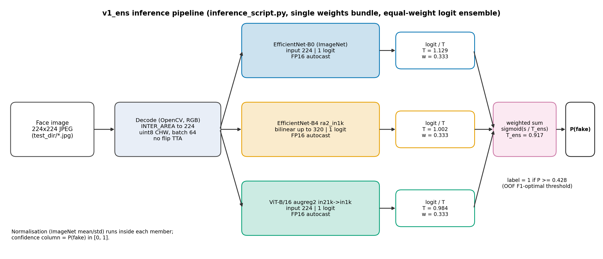
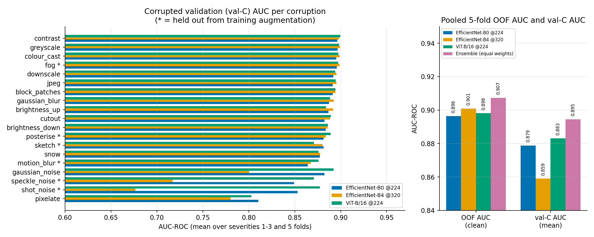

# Robust Deepfake Face Detection under Heavy Corruption

**Deepfake ML Hackathon, Synergy '26 (IIIT Bangalore)** · Team **abhijayjindal604** (solo) · 2-page summary of the technical report

## 1. Problem and approach

The task is to output P(fake) for 3,000 unlabelled 224×224 face crops; the main score is AUC-ROC, with further points for T4 inference time and for robustness on undisclosed degraded variants. A data audit shaped everything: the images are in-the-wild photos with face swaps blended into real scenes, both classes carry heavy corruptions (snow, pixelation, block patches, blur, noise), all files share one JPEG quantisation table (so none of this is a label cue), and real/fake versions of the same source photo exist. We therefore built similarity groups and validate on **grouped 5-fold CV**, and we train with label-independent corruption augmentation. A **57-setting corruption benchmark (val-C)**, 18 settings from 6 corruption types never used in training, stands in for the hidden robustness variants. Only the provided data and ImageNet-pretrained backbones are used; test images are never used for training or selection.

## 2. Architecture

Every model is a thin wrapper around a `timm` backbone: ImageNet normalisation inside the model, global pool, dropout, and a zero-initialised 1-logit head (so training starts at p = 0.5; this alone lifted fold-0 AUC from 0.8449 to 0.8739). The shipped model is a **temperature-scaled logit average of three architecture-diverse members, with equal weights and no test-time augmentation**: EfficientNet-B0 (local texture, 224), EfficientNet-B4 (upsampled to 320 for finer blending detail) and ViT-B/16 (global consistency). Members from different families make different mistakes; the ensemble also hides B4's weakness to strong noise. The weights ship as one 410.5 MiB bundle.

## 3. Hyperparameter justification

Every value was either measured in a paired 3-fold A/B or follows from a stated constraint. A change is adopted only if the selection score (0.5 × clean AUC + 0.5 × mean val-C AUC) improves by at least **0.006** (about 2× the measured seed-noise floor, RMS 0.0032) with the same sign on all three folds; ties go to the simpler option. Adopted for EfficientNet-B0: corruption probability **0.9**, stochastic depth **0.2** (+0.0075, 3/3), label smoothing **0.10** (labels are noisy), EMA **0.998**, **12 epochs** (8 epochs lost 0.021 on the worst held-out cell), AdamW with LR **3e-4 / 1e-3**, weight decay 0.05, 1-epoch warm-up and cosine decay. A gentler 1e-4 LR was rejected (held-out −0.030). Larger backbones use lower LRs with layer-wise decay (ConvNeXt/ViT 5e-5; B4 2e-4). Combined, the recipe moved B0 OOF AUC from 0.8715 to **0.8964**.

## 4. Training pipeline

Groups come from perceptual hashes plus ImageNet embeddings, merged with union-find (6,345 groups) and split with `StratifiedGroupKFold(5, seed 42)`. Training images get flip, mild affine, colour jitter and 1-2 of 13 "seen" corruptions at severity 1-3; the 6 held-out types are blocked by an assertion. Loss is BCE with label smoothing; the checkpoint is the **last-epoch EMA** (never the best epoch). Each chosen configuration is retrained once on 100 % of the 7,000 images for the same 12 epochs; full-data training-loss curves match the 5-fold means within 1.7-3.3 %. The ensemble (temperatures, equal weights, threshold) is selected from out-of-fold predictions only. Training used one laptop RTX 5060 for about 3 GPU-hours in total.

## 5. Results {: .pb }

| metric (grouped 5-fold, 7,000 OOF predictions) | B0 baseline | single B0 recipe | **final ensemble** |
|---|---|---|---|
| OOF AUC-ROC | 0.8715 | 0.8964 | **0.9074** |
| mean val-C AUC (57 settings) | n/a | 0.8789 | **0.8945** |
| worst val-C setting (pixelate, severity 3) | 0.544 | 0.742 | **0.768** |
| decision threshold (OOF F1-max) / F1 / accuracy | n/a | n/a | **0.4282** / 0.8784 / 0.8764 |
| inference, 3,000 images, Tesla T4 (Kaggle) | n/a | n/a | **110.8 s cold (1.85 min), 60.4 s warm** |

Per-fold ensemble AUC is 0.894 / 0.914 / 0.921 / 0.890 / 0.919. The T4 time is inside the top efficiency band (under 5 min). 

Grad-CAM maps on validation images show the members mostly attend to the central face region.

## 6. Limitations

- val-C is our guess at the hidden degradations; such as heavy recompression chains or adversarial noise could lower real robustness.
- Unseen generation methods are only approximated: leave-one-cluster-out AUC falls from 0.889 to 0.780 (worst cluster 0.631).
- Self-blended pseudo-fakes and mask supervision did not help (an SBI-only model scores 0.53 AUC), so we have no generic blending-artefact detector.
- No big backbone beat B0 alone by the +0.01 bar; the ensemble gain (+0.0065 OOF AUC) is modest and comes from diversity.
- Full-data models have no validation set of their own, and many decisions were made on three folds with one seed.

## 7. Reproducibility

Python 3.10, PyTorch 2.11 and `timm` 1.0.30, all pinned in `requirements.txt` (training) and `requirements-infer.txt` (inference). Seed 42 everywhere; inference is deterministic (byte-identical CSVs on re-run), offline (`pretrained=False`), and the T4 run matched our local predictions with 0 label flips. Organiser command:

    python inference_script.py --test_dir ./test/images/ --weights ./model_weights.pt --output predictions.csv

The full 19-page technical report (`report.pdf`, in the Drive folder) has the audit, every ablation, the val-C appendix and the exact training commands. Source code: <https://github.com/abhijay-jindal-604/deepfake-detection-synergy26>
